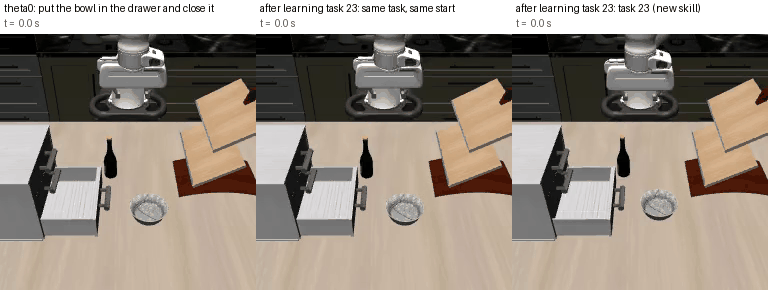
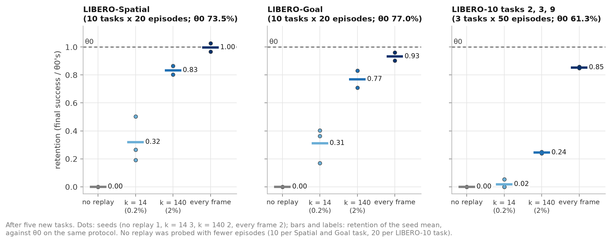

# Forgetting and replay in a deployed SmolVLA

How much does a deployed vision-language-action model forget when it is taught new manipulation
skills, and how much of its own training data has to be replayed to keep its old ones?



*One fine-tune erases an old skill. Left: θ0 does the LIBERO-10 task "put the black bowl in the
bottom drawer of the cabinet and close it". Middle: after a single fine-tune (1,000 steps) on new
task 23 in the same kitchen, the same task from the same start fails. Right: the fine-tuned policy
does task 23 itself (close the bottom drawer, open the top one). Played at about 1.5x real time.*

Without replay, θ0 loses nearly all of its old skills: one fine-tune on one new task takes its
success from about 75% to 0–27%, within 100 training steps in the run we tracked. Replaying part of
its own training data alongside five new tasks keeps about four fifths of its LIBERO-Spatial and
LIBERO-Goal success at 2% of the data and about a third at 0.2%, with no detectable loss when every
frame is replayed. Its long two-step tasks keep least, and splitting the budget by task length
roughly doubles what they keep.

We start from the released SmolVLA LIBERO checkpoint (θ0, `HuggingFaceVLA/smolvla_libero`, 605M
parameters) and teach it five new LIBERO-90 kitchen tasks one after another with its own fine-tuning
recipe (action expert only). Its old skills are re-tested on LIBERO-Spatial and LIBERO-Goal, in
scenes no new task uses, and on LIBERO-10's two-step tasks: tasks 2, 3 and 9 in the new tasks'
kitchens and tasks 0, 1, 4, 6 and 7 in living rooms. We call these evaluations probes. Fine-tuning
without replay is compared with random replay of θ0's training data (the four LIBERO suites,
judging by its normalizer statistics) and of the earlier new tasks, at budgets from 0.2% of the data
to every frame. Earlier VLA studies replay the earlier tasks of a sequence or mix pretraining data
into a single fine-tune; here a deployed model's own data is replayed through a sequence of new
tasks.

*Retention* is a run's final success on a probe divided by θ0's. A difference is *detectable* when
its 95% interval over episodes excludes zero. The full write-up, with methods, per-run tables,
predictions and limitations, is **[docs/report.md](docs/report.md)**.


## Findings

1. **One fine-tune erases θ0's skills.** After one new task, θ0's success on its old suites falls
   from about 75% to 0–27%. On the two probes tracked during training (a kitchen LIBERO-10 task and
   Spatial) the skills are gone by step 100, before the new task is learned. A 10x lower learning
   rate does not prevent it.
2. **Without replay, a sequence keeps only the last task.** After five new tasks every earlier task
   and every old skill is at 0%.
3. **Replaying θ0's own data protects it, and the budget sets how much.** Success after five new
   tasks (a budget is the share of θ0's training data kept, split equally per task unless stated:
   2% is 140 frames for each of its 40 tasks; the earlier new tasks get the same number):

   | Replay budget | Seeds | LIBERO-Spatial | LIBERO-Goal | LIBERO-10, kitchen tasks |
   |---|---|---|---|---|
   | θ0 (reference) | | 73.5% | 77% | 61% |
   | none | 1 | 0% | 0% | 0% |
   | 0.2% | 3 | 14–37% | 13–31% | 0–3% |
   | 2% | 2 | 59–63.5% | 54.5–64% | 15% |
   | 2%, split by task length | 2 | 57–58% | 54.5–56.5% | 26–29% |
   | every frame | 2 | 71–75.5% | 69.5–74% | 52–53% |

   

   *Retention after five new tasks, without replay and at the three equal-split budgets. Dots are
   seeds, bars their mean.*

   2% keeps about four fifths of θ0's Spatial and Goal success and 0.2% about a third. Every frame
   shows no detectable loss on them: the model can keep these skills while it learns, so what the
   smaller budgets lose is not explained by capacity alone. The long LIBERO-10 tasks are the
   exception: even with every frame they end detectably below θ0 (retention 0.85). At 0.2% the loss
   grows with every new task, so a test after one new task overstates what a small budget keeps.
4. **A tiny buffer costs new-task learning.** At 0.2% the new tasks learn about 10 pts less than
   without replay, although replay runs train twice as long, and the stored frames are memorized.
   With an equal split, the average cost from 2% up is not detectable.
5. **What 2% loses most is θ0's long, two-step tasks (LIBERO-10).** They keep a quarter of θ0's
   success, in the new tasks' kitchens and in the living rooms alike. In the kitchens both steps fail
   more often and the losses compound. Even with every frame, task 9 keeps under half.
6. **Splitting the budget by task length helps the long tasks (two seeds).** An equal split gives a
   LIBERO-10 task about half a demo's worth of frames. Splitting the same 2% in proportion to task
   length raises kitchen LIBERO-10 success from 15% to 26–29% and living-room success from 7–12% to
   16–20% (θ0: 35%), in both seeds; in the kitchens most of the gain is task 2, and task 3 ends lower.
   Spatial, Goal and new-task learning show no detectable difference from the equal split, but
   new-task learning is 5.4 pts below no replay, a detectable cost. Length may matter beyond
   coverage: longer Spatial and Goal tasks also keep less, even after single fine-tunes without
   replay (report, section 5).
7. **One new task is not kept by replay.** Task 23, whose demos never close the gripper, is lost at
   0.2% and 2% and only partly kept with every frame (8 and 32% success in two seeds).
8. **At 0.2%, which frames are stored decides much of the result.** Three runs ended at 14, 19.5 and
   37% on Spatial. Crossing the seeds shows the buffer seed (which frames are stored and how they
   fill the batches) trades Spatial against Goal by 16 to 22 pts, while the training seed moves each
   by under 5.

Caveats that apply throughout: one checkpoint and one recipe, five new tasks in one order, and
LIBERO's fixed initial states (so retention of in-distribution behaviour, not general skill). In our
pipeline θ0 scores below the SmolVLA paper (73.5 and 77% on Spatial and Goal, against 90 and 92%).
Seeds are few: seed noise is estimated only at 0.2%, where three seeds detect only differences of
about 30 pts on one suite but about 6 on the Spatial and Goal mean (seen after the results); for
two-seed conditions we can only say whether both seeds agree. Every number in the report traces to
a row of [results/](results/), except a few computed from per-episode outputs or dataset metadata
(report, appendix A); [results/README.md](results/README.md) explains the columns, run labels and
experiment ids.

**Open questions.** Random buffers hold each step of the long tasks at its share of the demos;
whether sampling a step above its share helps is untested. Also open: how a fixed budget is split
across tasks and over the stages, what about task length makes a task fragile, the one new task
that replay cannot keep, and methods that need no stored data.

## Reproducing

### What you need

- Linux, an NVIDIA GPU with CUDA 12.6, Python 3.13 and cmake. All results come from one A100
  (80 GB) per job; we did not test smaller GPUs. A CPU-only machine runs the tests but is far too
  slow for evaluation.
- About 2.4 GB of RAM per simulated episode. The protocol runs all episodes of a task at once, so a
  50-episode evaluation needs about 120 GB (the launchers request 160 GB); smaller batches would
  change the protocol.
- About 30 GB of disk for models, data and the Python environment.
- Compute: one replay sequence (five stages and its final probes) takes 6–7 A100-hours. The
  cheapest check of the main effect is θ0's reference and the single fine-tune in step 5.
  Fine-tuned checkpoints are not published yet, so every result needs its training runs.
- Slurm, or one machine with `scripts/run_local.sh` in place of `sbatch` (next section).

### Slurm or a single machine

The launchers (`*.sbatch`) carry the resource requests the runs used and a placeholder partition.
On Slurm, set yours once per shell; the chain scripts pass it on to every job they submit:

```bash
export SBATCH_PARTITION=<your-partition>   # also SBATCH_ACCOUNT, SBATCH_QOS if your site needs them
```

Submit from the repository root, or set `AVLA_REPO`. Every batch job starts `scripts/memguard.py`,
which kills the job at 90% of its `--mem` request, for sites that do not enforce memory limits.

On one machine with a GPU, `scripts/run_local.sh` stands in for `sbatch`: it runs a launcher right
away and returns when it has finished, so a chain's jobs run one after another (logs in
`slurm-<job>.out` here). No memory watchdog runs. The replay stages also evaluate along the way, up
to about 145 GB at once; `AVLA_STAGE_PROBES=0` skips those evaluations, and the final probes still
run. We have tested this path's plumbing, not a full run.

```bash
export AVLA_SBATCH=scripts/run_local.sh                     # the chain scripts in step 5 now run here
bash scripts/run_local.sh scripts/convert_libero90.sbatch   # a single launcher: replace "sbatch"
```

### 1. Install

On a machine with internet access:

```bash
git clone https://github.com/elvinhajizada/adaptive-vla-replay.git && cd adaptive-vla-replay
bash scripts/build_env.sh        # .venv with the exact versions in requirements-lock.txt (CUDA 12.6);
                                 # needs python3.13 on PATH, or AVLA_PYTHON=/path/to/python3.13
# CPU-only machine instead (tests and plumbing checks; needs uv): bash scripts/build_env_cpu.sh
```

### 2. Download the models and data

```bash
AVLA_ONLINE=1 source scripts/env.sh   # allow downloads in this shell
python scripts/download_assets.py     # θ0, SmolVLM2, the nvidia dataset, LIBERO assets, at pinned revisions
```

Every later shell and job runs `source scripts/env.sh` without `AVLA_ONLINE`. That activates the
environment and switches to offline mode, so runs load only the pinned files from the local cache.
Data lives under `$AVLA_DSS` (default `~/avla-data`; set it before sourcing to move it). Rendering
uses EGL where an NVIDIA GPU is visible and OSMesa elsewhere (`AVLA_GL=egl|osmesa` overrides).

### 3. Check the setup

```bash
source scripts/env.sh
python -m pytest tests/              # unit tests, CPU
sbatch scripts/smoke_gpu.sbatch      # GPU node: LIBERO env reset and a 2-episode θ0 eval, ends with "SMOKE DONE"
```

Without Slurm, run `bash scripts/smoke.sh cuda` on the GPU machine instead.

### 4. Convert the data (once, CPU)

```bash
j=$(sbatch --parsable scripts/convert_libero90.sbatch)               # LIBERO-90 -> θ0's conventions, verified
sbatch --dependency=afterok:${j%%;*} scripts/convert_theta0_suites.sbatch   # θ0's own four suites, merged with it (replay data)
```

### 5. Reproduce the results

Each experiment is a chain of jobs: one per training stage, then one for the final probes (all
Spatial and Goal tasks, the kitchen LIBERO-10 tasks and the earlier new tasks). A chain script
submits the whole chain at once; each job starts when the previous one has finished. Training runs
are written to `$AVLA_RUNS/train/<job>/`, evaluations to `$AVLA_RUNS/eval/<suite>/<job>-<label>-r256/`
(r256: the render size). In order of cost:

**θ0's reference**: θ0 itself on the final probes, the baseline for every retention number.

```bash
sbatch scripts/probe_eval.sbatch \
    "$HF_HOME/hub/models--HuggingFaceVLA--smolvla_libero/snapshots/6721902bc4d61e50a3bfdb11dfb4cb626f05d102" \
    theta0-final libero_spatial:all:20 libero_goal:all:20 "libero_10:[2,3,9]:50"
```

**One fine-tune**: train θ0 on new task 23 for 1,000 steps and evaluate it on that task, then
measure what it forgot with the probes of the report's Table 2 (θ0's row there is the reference).

```bash
sbatch scripts/finetune_eval.sbatch 23 1000
JOB=...    # the job id the line above printed; start this once that job has finished
sbatch scripts/probe_eval.sbatch "$AVLA_RUNS/train/$JOB/checkpoints/last/pretrained_model" \
    ft23 "libero_10:[3]:50" libero_spatial:all:10 libero_goal:all:10
```

**No replay**: the same five tasks with plain fine-tuning, training seed 1000.

```bash
bash experiments/replay/seq_chain.sh
```

**Replay.** One run teaches θ0 the five new tasks in order, replaying stored frames alongside each
one, and ends with the final probes:

```bash
bash experiments/replay/er_seed_chain.sh K BUFFER_SEED TRAINING_SEED
```

- `K`: frames kept per task: `14` (0.2% of θ0's data), `140` (2%) or `all`.
- `BUFFER_SEED`: which frames are stored, which of them fill each batch, and the order of the new
  task's frames.
- `TRAINING_SEED`: the rest of training's randomness, mainly the noise and time draws of the
  flow-matching loss.

Separate seeds let either be varied with the other fixed. The report's runs change both together
(0/1000, 1/1001 and 2/1002, its seeds 1 to 3):

```bash
for s in "0 1000" "1 1001" "2 1002"; do bash experiments/replay/er_seed_chain.sh 14 $s; done
for s in "0 1000" "1 1001"; do bash experiments/replay/er_seed_chain.sh 140 $s; done
for s in "0 1000" "1 1001"; do bash experiments/replay/er_seed_chain.sh all $s; done
for s in "0 1000" "1 1001"; do bash experiments/replay/e50_prop_chain.sh $s; done   # 2%, split by task length
```

**Everything else** (the crossed seeds, the fresh buffer, the living-room probes and the analyses):
[results/README.md](results/README.md) lists, for each section of the report, the launcher, its
arguments, and the run labels in `results/runs.csv`.

**Tables and figures.** The figure script draws the report's figures from the CSVs shipped in
`results/`; it selects our runs by their job ids. The collector gathers your runs into the same
tables, in a directory of your choice, to compare with ours:

```bash
python scripts/make_figures.py                       # docs/figures/ from results/*.csv
python scripts/collect_results.py --out my_results   # your runs under $AVLA_RUNS as CSV tables
```

## Pitfalls this repo handles

- **The nvidia LIBERO-90 data needs a conversion** before training θ0 on it: another wrist-camera
  key and a flipped gripper convention (1 open / 0 close instead of -1 open / +1 close). Trained on
  it unchanged, θ0 learns to drive the gripper backwards and nothing errors.
- **`lerobot-train` replaces a pretrained policy's normalizer stats with the dataset's** when
  fine-tuning. Left alone, each stage would re-normalize θ0 and show forgetting that is not real;
  the converted datasets carry θ0's own stats.
- **Render at 256x256**, θ0's training size: the environment default (360x360) costs 12 pts on
  LIBERO-Spatial.
- **θ0 has 605M parameters**, not the paper's 450M: it keeps all 32 SmolVLM2 layers (the 450M refers
  to `smolvla_base`, which keeps 16). 97.5M of them, the action expert, are trained.
- SmolVLA loads its VLM by name without a revision; `download_assets.py` pins that name's offline
  revision, so a cached run cannot silently pick up a newer model.

Details: [docs/LIBERO.md](docs/LIBERO.md) (data formats, conventions, protocols, published numbers).

## Layout

```
adaptive_vla/              # the package (CPU-testable parts in tests/)
  config.py                #   every setting in one place: pinned revisions, the five tasks, probes,
                           #     training recipe, replay budgets, evaluation protocol
  libero_data.py           #   nvidia LIBERO-90 -> θ0's conventions (camera key, gripper sign,
                           #     normalizer stats); task lookup by instruction; passes -> steps
  replay.py                #   replay buffer of frame handles and the sampler that mixes replay
                           #     into each batch (torch-free)
  metrics.py               #   success-matrix metrics: forgetting, NBT, normalized forgetting,
                           #     gap recovered, bootstrap intervals (NumPy only)
  checkpoints.py           #   slim checkpoints (only tensors that differ from θ0, lossless),
                           #     rebuilding them, weight interpolation
  provenance.py            #   run_info.json next to every run: commit, pinned revisions, command
  lerobot_glue.py          #   loading θ0, checkpoints and datasets through the pinned LeRobot
  subgoals.py, subgoal_env.py      # per-episode sub-goal logging during evaluation, and its summary
  lang_diag.py, lang_diag_env.py   # the language check: true, blank and swapped instructions
scripts/                   # the reusable pipeline
  env.sh, build_env*.sh, download_assets.py   # environment, offline cache, pinned assets
  convert_*.py             #   data conversion and verification
  train.sh, replay_train.py, replay_spec.py   # fine-tuning, with or without replay
  eval.sh, probe_eval.sbatch                  # evaluation at the protocol settings
  run_local.sh, memguard.py                   # running without Slurm; per-job memory watchdog
  collect_results.py, make_figures.py         # results/*.csv and the report's figures
experiments/               # one launcher or analysis per experiment (which is which: results/README.md)
  setup/                   #   data and evaluation checks, θ0 baselines (report section 2)
  single_finetune/         #   one fine-tune and how it forgets (section 3)
  replay/                  #   replay sequences and their analyses (sections 4 to 7)
  coverage/                #   offline buffer coverage
tests/                     # CPU unit tests
results/                   # every evaluation and training run as CSV, with a column guide
docs/report.md             # the write-up
docs/LIBERO.md             # LIBERO background: data, conventions, protocols, published numbers
docs/figures/              # the report's figures and the rollout GIF
SOURCE                     # the private development commit this repository was exported from
```

## Credits and licences

Code in this repository: Apache-2.0 ([LICENSE](LICENSE)). It ships no datasets or checkpoints; the
environment build and `scripts/download_assets.py` fetch them from their sources at pinned revisions,
under their own terms:

- [LeRobot](https://github.com/huggingface/lerobot) (Apache-2.0), used as a library at commit
  `9a6bb61` (version 0.6.2). The training patches in `scripts/` import and wrap its functions; no
  LeRobot source is copied here.
- [`HuggingFaceVLA/smolvla_libero`](https://huggingface.co/HuggingFaceVLA/smolvla_libero) (θ0) and
  [`HuggingFaceTB/SmolVLM2-500M-Video-Instruct`](https://huggingface.co/HuggingFaceTB/SmolVLM2-500M-Video-Instruct),
  both Apache-2.0.
- [`nvidia/LIBERO_LeRobot_v3`](https://huggingface.co/datasets/nvidia/LIBERO_LeRobot_v3),
  OpenMDW-1.1.
- [LIBERO](https://github.com/Lifelong-Robot-Learning/LIBERO) (MIT, Copyright (c) 2023 Lifelong Robot
  Learning), via the `hf-libero` package (MIT) and the `lerobot/libero-assets` copy of its
  simulation assets. The rollout frames in the GIF and figures are rendered from these assets.

Related work and references: [docs/report.md](docs/report.md), sections 8 and References.

## How to cite

Elvin Hajizada. *Forgetting and replay in a deployed SmolVLA.* 2026. Citation metadata:
[CITATION.cff](CITATION.cff).

```bibtex
@misc{hajizada2026forgetting,
  author = {Hajizada, Elvin},
  title  = {Forgetting and replay in a deployed {SmolVLA}},
  year   = {2026},
  url    = {https://github.com/elvinhajizada/adaptive-vla-replay}
}
```
