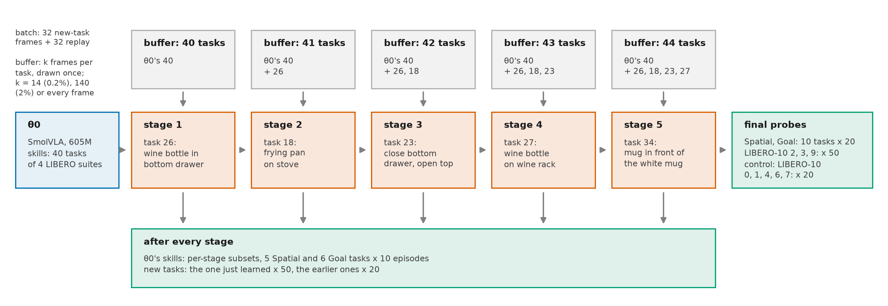
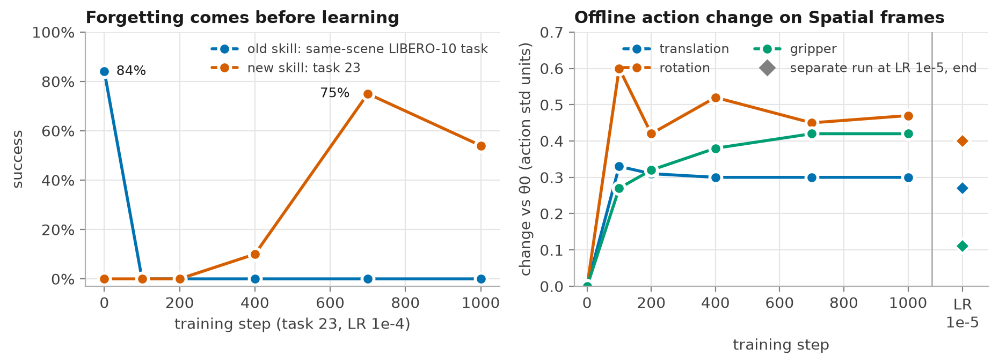
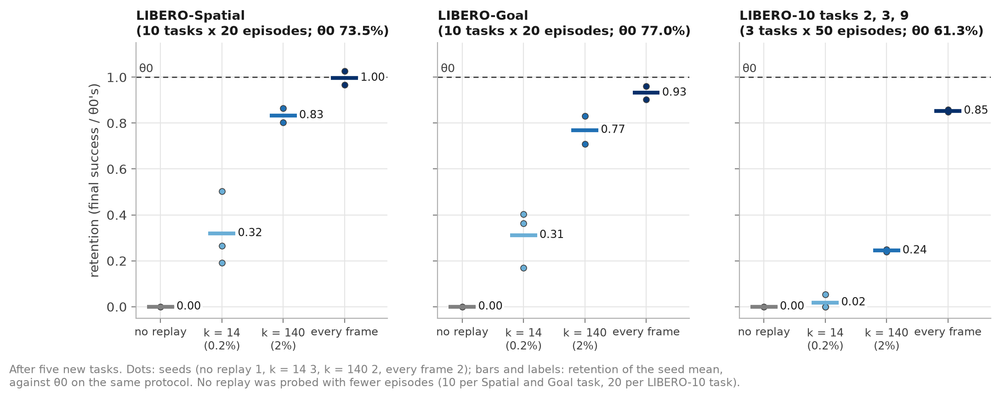
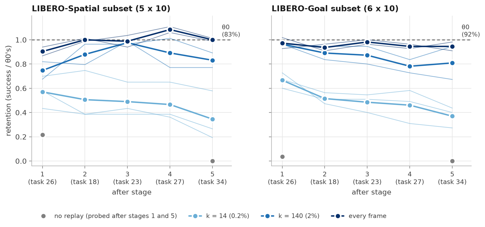
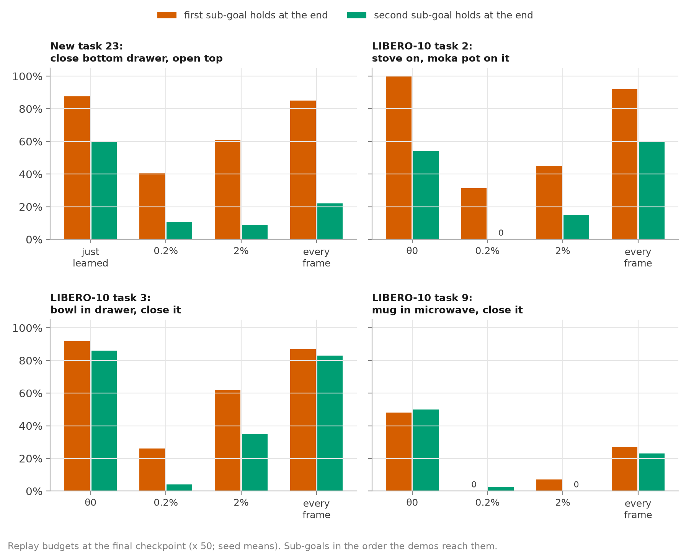
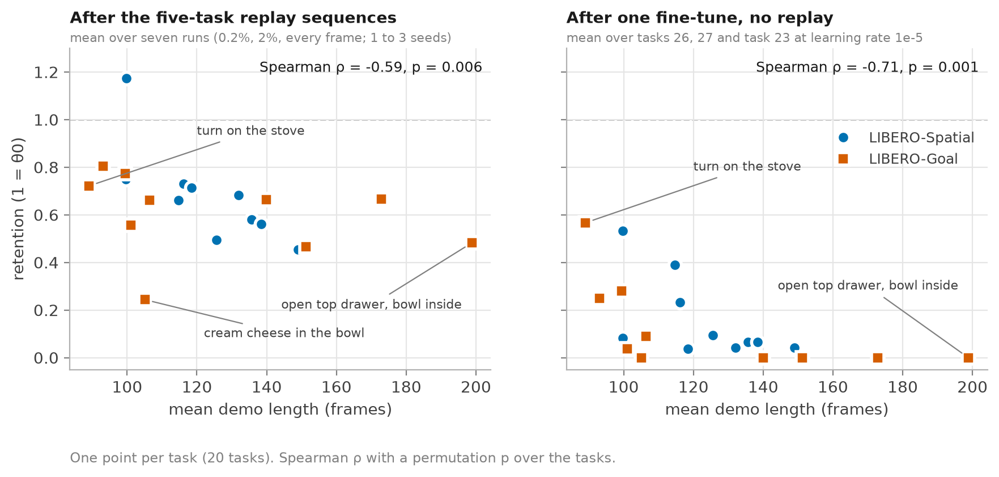
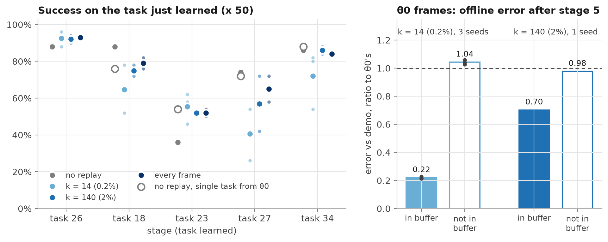
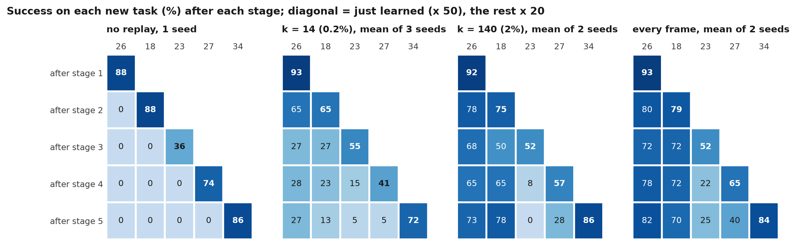

# Forgetting and replay in a deployed SmolVLA

_Version 1.4, 2026-11-09._

## Abstract

A deployed robot policy will be fine-tuned on new tasks, usually by whoever holds its training
data. We teach the released SmolVLA checkpoint for LIBERO five new LIBERO-90 tasks in sequence, with
its own fine-tuning recipe, and measure how much of its own training data has to be replayed to keep
its skills.

Without replay, the model forgets fast: one fine-tune takes its success on its old suites from about
75% to between 0 and 27%, and in the fine-tune we tracked, the skills were gone within 100 optimizer
steps, before the new task was learned. Replaying a fixed random sample of the training data reduces
this, and the size of the sample sets how much. After five new tasks, on two suites in scenes that
no new task uses, replaying every frame keeps the model's success with no detectable loss, 2% keeps
about four fifths and 0.2% about a third. At 0.2%, retention keeps falling from stage to stage.

The model's long LIBERO-10 tasks keep a quarter of their success at 2%, about as much in living rooms
that no new task uses as in the new tasks' own kitchens. An equal split of the budget gives each of
these tasks about half a demo. Splitting the same 2% by task length roughly doubles their retention
in both scene groups and in both of two seeds, though in the kitchens one task carries most of the
gain.

At 0.2% the new tasks learn about 10 pts less and the buffer is memorized. Results at this budget
vary by up to 23 pts between seeds, mostly with which frames the buffer holds, so three seeds per
condition detect only differences of roughly 29 to 36 pts on Spatial or Goal alone. The buffer seed
moves success from one of these suites to the other, and on their mean three seeds would detect
about 6 pts. All numbers come from closed-loop simulation on LIBERO's fixed initial layouts, with one
model and one task order; in our pipeline the model scores below its paper's LIBERO results.

## 1. Introduction

A robot policy that is already deployed will be asked to learn new tasks, and whoever deploys it
usually holds the data it was trained on. We take a released vision-language-action (VLA) model,
the SmolVLA checkpoint for the LIBERO benchmark, which we call θ0 [1]. We teach it new LIBERO-90
tasks one after another with its own fine-tuning recipe and ask two questions: how many of its own
skills does it lose, and how much of its own training data has to be replayed to keep them?

The first answer is that it loses nearly all of them, and fast. After one fine-tune on a single new
task, θ0's success on LIBERO-Spatial and LIBERO-Goal falls from about 75% to between 0 and 27%, and
on LIBERO-10 tasks in the new tasks' kitchens to 0. During one fine-tune, both probes we tracked, a
LIBERO-10 task and LIBERO-Spatial, were gone after 100 optimizer steps, before the new task was
learned, and a 10x lower learning rate did not prevent the loss (section 3).

Experience replay, which mixes stored data from earlier tasks into each training batch, prevents
this in other VLA studies. Pretrained VLAs such as π0 and GR00T N1.5 forget little in LIBERO task
sequences when trained with it, and much without it [2]; their buffers hold the earlier tasks of the
sequence. Fine-tuning π0 on a new LIBERO task erodes its pretraining tasks, and mixing pretraining
data back into the fine-tune reduces the loss [3]. A deployed model needs the second setting carried
through a sequence of tasks. We therefore teach θ0 five new tasks in a row, one fine-tuning stage per
task, and replay a fixed random sample of θ0's own training data alongside each: 0.2% or 2% of that
data, or every frame of it.

We report retention: the final success on a probe after the new tasks, divided by θ0's own success
on it. The probes sit at different distances from the new tasks, from suites set in other scenes to
LIBERO-10 tasks in the new tasks' own kitchens (section 2.3). The results answer the second question
in three parts.

First, the budget sets retention (section 4). After five new tasks, 2% of θ0's data keeps about four
fifths of its success on the suites in other scenes, and every frame keeps it with no detectable
loss. At 0.2% retention keeps falling over the sequence, so a test after a single new task
overstates what a small budget keeps; drawing a fresh buffer at every stage recovers part of that
decline.

Second, what a 2% budget loses is concentrated in θ0's long LIBERO-10 tasks, near the new tasks and
far from them alike (section 5). Among θ0's Spatial and Goal tasks, longer ones keep less, with or
without replay. Part of the LIBERO-10 loss comes from how the budget is split: giving each task
frames in proportion to its length roughly doubles their retention in both scene groups and both
seeds, though in the kitchens most of the gain comes from one task.

Third, the smallest budget has costs of its own. At 0.2% the new tasks learn about 10 pts less and
the buffer is memorized (section 6). Results also vary by up to 23 pts between seeds, mostly with the
buffer seed, which moves success between Spatial and Goal. Three seeds per condition therefore detect
roughly 29 to 36 pts on one suite but about 6 pts on their mean (section 7).

The study is small and controlled: one checkpoint, one recipe, five new tasks in one fixed order,
LIBERO's fixed initial layouts, and one to three seeds per condition. Retention here means that θ0
still reproduces trained behaviour from known layouts, which is most of what LIBERO measures [4].

## 2. Setup

Figure 1 shows the protocol; the subsections below give its parts.

*Figure 1. The sequence. Each stage trains one new task for 8 passes over its demos, with half of each
batch drawn from a buffer that holds k frames of each of θ0's 40 tasks and of every new task already
learned. Probes run after every stage and, more widely, after the last. Without replay there is no
buffer and the probes are the same. "10 tasks x 20" means 20 episodes of each of 10 tasks.*

### 2.1 θ0 and its training data

θ0 is the released SmolVLA checkpoint for LIBERO, `HuggingFaceVLA/smolvla_libero` [5]. SmolVLA
pairs a SmolVLM2 vision-language backbone with a separate action expert, a transformer trained by
flow matching that outputs chunks of 50 actions [1]. θ0's model card names `lerobot/smolvla_base` as
its base, but θ0 keeps all 32 language-model layers (605M parameters) where the paper keeps 16. θ0
executes one action of each chunk and then replans. Fine-tuning follows θ0's own recipe, which trains
the action expert and the state projection (97.5M parameters) and leaves the vision encoder and the
language model frozen.

θ0's target is LIBERO, a simulated manipulation benchmark with a Franka arm [6]. Each task is
defined by a scene, a language instruction and a set of goal predicates (for example "the bowl is in
the bottom drawer" and "the bottom drawer is closed"); an episode succeeds when all predicates hold
at once. Training data are human teleoperated demos, and evaluation starts from 50 fixed initial
object layouts per task. θ0's model card names no training data. Its normalizer statistics are
identical to those of `lerobot/libero` [7], which holds the four suites LIBERO-Spatial,
LIBERO-Object, LIBERO-Goal and LIBERO-10 (40 tasks, 1,693 demos), so we take that set to be θ0's
training data. We call these 40 tasks θ0's skills.

The new tasks' demos come from a second LeRobot copy of LIBERO that also contains LIBERO-90 [8]. We
convert it to θ0's conventions and write θ0's own normalizer statistics into the converted dataset,
since otherwise both the copy's gripper encoding and the pinned `lerobot-train` [9], which replaces a
policy's statistics with the dataset's, would show up as forgetting (appendix A). θ0's four suites,
converted from the same copy, supply the replay buffer.

### 2.2 Five new tasks

The new tasks had to be ones θ0 cannot already do. On the 11 LIBERO-90 kitchen tasks that have demos
from a single scene, θ0 solved 2 of 110 episodes. Five of these candidates are each one sub-goal of
a LIBERO-10 task θ0 was trained on, in the same scene, and θ0 fails them although it solves the
whole task: it completes "put the black bowl in the bottom drawer of the cabinet and close it" in 42
of 50 episodes but closes the drawer on its own in none of 10. We left these five out, since after
training on one, a change on the probe that contains it could be transfer as much as forgetting. We
also left out the one candidate from kitchen scene 8, whose LIBERO-10 task θ0 solves only 16% of the
time, too low to show a drop. The remaining five are the new tasks of Table 1, trained in that order
in every condition, so order effects are not measured. θ0 fails each in all 10 zero-shot episodes.
Two of them, tasks 23 and 26, still use the bottom drawer of LIBERO-10 task 3, a confound for that
probe, and task 23's demos never close the gripper, unlike those of every other new task and of all
40 of θ0's own tasks.

*Table 1. The five new tasks, in training order. Sub-goals: number of goal predicates. Single-task
fine-tune: 8 passes from θ0, 50 episodes.*

| Order | Task (LIBERO-90 id) | Kitchen scene | Sub-goals | Demos | θ0 zero-shot | Single-task fine-tune |
|---|---|---|---|---|---|---|
| 1 | put the wine bottle in the bottom drawer of the cabinet (26) | 4 | 1 | 43 | 0/10 | 88% |
| 2 | put the frying pan on the stove (18) | 3 | 1 | 47 | 0/10 | 76% |
| 3 | close the bottom drawer of the cabinet and open the top drawer (23) | 4 | 2 | 34 | 0/10 | 54% |
| 4 | put the wine bottle on the wine rack (27) | 4 | 1 | 39 | 0/10 | 72% |
| 5 | put the yellow and white mug to the front of the white mug (34) | 6 | 1 | 44 | 0/10 | 88% |

### 2.3 Probes

Old skills are re-tested on probes that differ in how much they overlap with the new tasks. We
expected forgetting to grow with overlap, so a probe far from the new tasks alone could have made it
look small. LIBERO-Spatial (10 tasks) is set in scenes that appear in no new task. LIBERO-Goal (10
tasks) is also set in a scene that no new task uses, but it shares objects with them (bowls, plates,
a wine bottle and rack), and its instruction "put the wine bottle on the rack" nearly repeats new
task 27's. The kitchen tasks are the three LIBERO-10 tasks set in the new tasks' kitchens (ids 2, 3
and 9), the old skills where interference is most likely. Each has two sub-goals, goal predicates
that the demos reach one after the other (for task 3, "the bowl is in the drawer", then "the drawer
is closed"). Five more LIBERO-10 tasks with two sub-goals, the living-room tasks (ids 0, 1, 4, 6 and
7), are set in rooms that no new task uses and serve as a control (section 5.1).

The final probes run after the last stage: every Spatial and Goal task at 20 episodes, the kitchen
tasks at 50 and the living-room tasks at 20. After every stage, per-stage subsets track the
sequence: the five tasks of each suite that θ0 solves most often, which have the most room to show a
drop, plus the Goal wine-rack task, at 10 episodes each. LIBERO-Object, θ0's fourth suite, is not
probed: like Spatial, it repeats one pick-and-place motion in scenes that no new task uses, so it
would add a second probe of the same kind. The probes cover 28 of θ0's 40 tasks.

θ0 follows the instruction on Goal, whose tasks share one scene and differ only in instruction. On
three Goal tasks it succeeds in 25 of 30 episodes with the true instruction and in none with a blank
one, and given another task's instruction it reaches that other task's goal in 26 of 30. On the tasks
tested, interference between tasks that share a scene therefore cannot be put down to a policy that
ignores language.

### 2.4 Training and replay

Every new task is trained with θ0's recipe (AdamW, peak learning rate 1e-4 with warmup and cosine
decay, batch 64) for a fixed 8 passes over its demos. Each stage starts from the previous stage's
weights with a fresh optimizer and learning-rate schedule. We fixed training length in passes because
longer training fit the demos more tightly without detectably raising success: on task 23, tripling
the steps more than halved the final loss, while success at 1k, 2k and 3k steps was 54, 64 and 48%
(appendix D). With 50 episodes per run, that check would miss a difference of up to about 26 pts.

Replay runs use the same recipe and add a buffer: k random frames from each of θ0's 40 tasks and
from every new task already learned, drawn once and kept for the whole sequence. Each batch holds 32
frames of the current task and 32 from the buffer, as in the 1:1 mixing of [2]. Buffer frames are
sampled uniformly over tasks, then over a task's frames. Because a stage always runs 8 passes over
the new task's frames and replay takes half of each batch, replay doubles a stage's optimizer steps.
Since the training-length check could miss a sizeable effect, the extra steps remain a confound in
every comparison of new-task learning with and without replay, one that would favour the replay runs.

We name a budget by the share of θ0's data it holds. θ0's 40 tasks have 273,465 frames, so k = 140
frames per task (5,600 in all) is 2% and k = 14 is 0.2%; the third budget is every frame. Every task
gets the same k, so long tasks have lower coverage, the share of a task's demo frames held in the
buffer. At 2% a Spatial or Goal task keeps about one demo's worth of frames, and a LIBERO-10 task,
whose demos are about twice as long, about half.

Each run has two seeds. The buffer seed sets the data stream: which frames enter the buffer, which
buffered frames fill each batch, and the order of the new task's frames. The training seed sets the
rest of training's randomness, mainly the noise and time draws of flow matching. A replicate changes
both together, and section 7 crosses them. Runs at different budgets share seed values but not
buffers, so they are not paired.

### 2.5 Evaluation

Every number comes from closed-loop episodes in LeRobot's LIBERO evaluation: the policy's actions
run in the simulator, so each frame it sees depends on what it did before. Episodes start from
LIBERO's fixed initial states, with a full reset before every episode and one evaluation seed.
Repeated evaluations of one checkpoint still differ in about 6% of episodes (two runs of θ0 agreed
on 122 of 130), because the renderer's output varies between runs (appendix D).

Episodes are rendered at 256x256, the frame size θ0 was trained on [7]; at the simulator's default
of 360x360 θ0 loses 12 pts on Spatial (appendix D).

Even at 256, θ0 scores below the SmolVLA paper's LIBERO results: 73.5% on Spatial and 77% on Goal,
against 90% and 92% for the paper's 0.45B model trained on a copy of the same demos [1]. No published
number exists for θ0 itself, and we have not found the cause of the gap. Every retention divides by
θ0 as evaluated here, so both sides of a comparison carry the gap, but a θ0 handicapped by our
pipeline could forget differently (section 9).

### 2.6 Metrics and uncertainty

The headline metric is retention, a run's final success on a probe divided by θ0's success on the
same protocol:

$$R = \frac{s_\text{run}}{s_{\theta_0}}.$$

θ0's reference for each probe pools every θ0 run on that protocol (Table 3, appendix B). Retention
measures θ0's skills. Forgetting of the new tasks themselves uses LIBERO's negative backward transfer
(NBT) [6], computed from the success matrix $S$, where $S_{ij}$ is the success on new task $j$ after
stage $i$ of $T = 5$:

$$\mathrm{NBT} = \frac{1}{T-1}\sum_{j=1}^{T-1} \frac{1}{T-j}\sum_{i=j+1}^{T}\left(S_{jj} - S_{ij}\right).$$

It is the average drop of each new task, except the last, from its success right after it was
learned to its success in the later stages. LIBERO takes $S_{jj}$ as the best success seen while
training task $j$; we evaluate only at the end of each stage and use that value, so our NBT is not
comparable as a number with published ones.

Episode noise comes from scoring a finite number of pass-or-fail episodes. We give 95% intervals over
episodes (bootstrap for single runs in appendix B, normal or delta-method approximations for pooled
comparisons, as stated where they appear), call a difference detectable when its interval excludes
zero, and otherwise report no detectable difference. The margin depends on the success rate: between
two 200-episode probes it is about ±10 pts near 50% success and about ±6 pts near 10%. θ0's
references for Goal and the kitchen tasks pool two evaluations of the same initial layouts, which
agree on most episodes, so their intervals treat θ0's episodes as more independent than they are;
section 5 notes the one conclusion this could change.

Seed noise comes from retraining with other seeds. We can estimate it only at 0.2%, the one budget
with three seeds, where it is larger than episode noise on each suite but not on the mean of Spatial
and Goal (section 7). For two-seed conditions we say whether both seeds agree, which does not show
how far a third seed would move.

Before each replay experiment we wrote down a prediction and, for most, a reading rule: thresholds,
fixed before the run, that decide how its result is read. Appendix C lists the predictions, rules
and outcomes, and which experiments were added after an earlier result. Two analyses had no
prediction: the sub-goal comparison of Table 4 and the second no-replay reference of section 6.

## 3. One fine-tune erases θ0's skills

After one fine-tune on a new task, θ0 fails on its old tasks, in scenes the new task never visits as
well as in its own (Table 2). Every checkpoint fails the same-scene task, LIBERO-10 task 3, in all 50
episodes, and no shared scene is needed for that zero: the task-26 and task-27 checkpoints also fail
kitchen tasks 2 and 9, in kitchens neither trained in, in all 100 episodes (θ0 48). On Spatial and
Goal, how much survives depends more on the new task than on the suite: nothing after task 23,
little after task 26, and a fifth to a third after task 27. Goal, whose wine-rack task nearly repeats
task 27's instruction, keeps 27% after task 27 against Spatial's 17%, no detectable difference, so
this run gives no evidence that the overlap protects Goal. Each checkpoint still solves its own new
task, keeps θ0's normalizer statistics and tokenizes every LIBERO instruction as θ0 does, so the
collapse does not come from the pipeline.

*Table 2. θ0's skills after one fine-tune on one new task (one run each), success (%). Same-scene
task: LIBERO-10 task 3, in kitchen scene 4 with tasks 23, 26 and 27, 50 episodes. Spatial and Goal:
10 tasks x 10 episodes from the same initial states as θ0's row.*

| Fine-tuned on | Same-scene task | Spatial | Goal |
|---|---|---|---|
| (θ0, no fine-tune) | 84 | 76 | 74 |
| task 23 | 0 | 0 | 0 |
| task 23, learning rate 1e-5 | 0 | 3 | 5 |
| task 26 | 0 | 12 | 2 |
| task 27 | 0 | 17 | 27 |

A 10x lower learning rate does not prevent the loss (Table 2). At a peak of 1e-5 the policy learns
only the first sub-goal of task 23, closing the bottom drawer without opening the top one, and still
forgets as much (one run).

The forgetting is also fast (Figure 2). From step 100 of the task-23 run, less than one pass over its
demos, the same-scene task fails in every episode and Spatial succeeds in at most 1 of 100; task 23
itself first succeeds at step 400. Offline, the drift of θ0's predicted actions on fixed Spatial
demo frames (their change from θ0's, in units of θ0's action standard deviation) reaches its final
size in arm motion by step 100, while the gripper part keeps growing until about step 700. The
lower learning rate leaves the arm drift nearly as large and only reduces the gripper's. These are
checkpoints of one run; Goal was not evaluated during training.

*Figure 2. Left: success on the same-scene task (old skill) and on new task 23 during task 23's
fine-tune; checkpoints of one run over 20 episodes, θ0 and the 1k-step end point (a separate run with
the same recipe) over 50. Right: drift of the predicted actions from θ0's on fixed Spatial demo
frames, in units of θ0's action standard deviation; diamonds, right of the divider: the end of a
separate run at a 10x lower learning rate.*

Over a sequence, the same happens to each new task in turn: without replay, a five-task sequence
keeps only the task learned last. Each new task is learned within 18 pts of its single-task
fine-tune (Table 1, Figure B1) and then lost entirely: every earlier task is at 0 from the next stage
on, and at the end every probe of θ0's skills is at 0. NBT is therefore 0.72, the mean just-learned
success of the first four tasks. The sequence ran with one seed, since at the floor more seeds would
re-measure zero.

## 4. The replay budget sets retention

After five new tasks, the replay budget sets how much of θ0's Spatial and Goal success survives
(Table 3, Figure 3): every frame keeps it with no detectable loss, 2% about four fifths and 0.2%
about a third. Every 0.2% seed ends more than 20 pts below both 2% seeds on both probes, twice the
episode margin on such a difference, so the budgets are separated in every pair of seeds; with three
budgets we cannot say where between 0.2% and 2% retention rises fastest.

*Table 3. Retention after five new tasks (final success divided by θ0's), seed mean, ± SD across
seeds where there are three; the θ0 row gives θ0's success. The fresh-buffer and split rows are
discussed in this section and in section 5.2. Per-seed success with intervals: Table B2.*

| Replay budget | Seeds | Spatial | Goal | Kitchen tasks (2, 3, 9) | Living-room tasks (0, 1, 4, 6, 7) | NBT, new tasks |
|---|---|---|---|---|---|---|
| θ0 (success) | | 73.5% | 77% | 61% | 35% | |
| none | 1 | 0 | 0 | 0 | not probed | 0.72 |
| 0.2% (k = 14) | 3 | 0.32 ± 0.16 | 0.31 ± 0.13 | 0.02 ± 0.03 | not probed | 0.45 ± 0.06 |
| 0.2%, fresh buffer each stage | 2 | 0.52 | 0.56 | not probed | not probed | not measured |
| 2% (k = 140) | 2 | 0.83 | 0.77 | 0.24 | 0.27 | 0.27 |
| 2%, split by task length | 2 | 0.78 | 0.72 | 0.45 | 0.51 | not measured |
| every frame | 2 | 1.00 | 0.93 | 0.85 | 0.84 | 0.19 |

*Figure 3. Retention after five new tasks, by replay budget and probe. Dots are seeds, bars the
seed mean; 1.00 is θ0 on the same protocol.*

Replaying every frame leaves Spatial and Goal with no detectable loss, though the Goal interval still
allows a loss of up to 13% of θ0's success (appendix B). The smaller budgets lose more on both
suites, so the policy's capacity alone does not explain their loss. At fixed steps and replay share,
a smaller buffer both holds fewer distinct frames and replays each one more often, and these runs
cannot tell which of the two limits it.

Over the sequence, retention at 0.2% keeps falling, so a test after a single new task overstates
what a small budget keeps (Figure 4). On the per-stage subsets it is about 0.6 of θ0 after the first
new task and about 0.35 after the fifth, on both probes. At 2% Spatial holds, and Goal falls in one
of the two seeds, from 53 to 37 of 60 episodes, while the other holds; with every frame neither
probe falls.

*Figure 4. Retention of θ0's skills on the per-stage subsets after each stage, by replay budget,
against θ0 on the same subsets (dashed line); thin lines are seeds, markers seed means. No replay was
probed after stages 1 and 5 only.*

Two things grow together over the stages: the number of new tasks learned, and how often each
buffered frame has been replayed, about 100 more times per stage at 0.2%. A buffer drawn anew at
every stage, with the same size, steps and mixing, recovers part of the decline: it ends at about
half of θ0's Spatial and Goal success, against about a third for every fixed 0.2% buffer (Table 3;
all five fixed-buffer runs, including the two of section 7, end at a Spatial and Goal mean of 22.5
to 28%). The fresh buffer's two seeds end at 47 and 34.5%, the second 6.5 pts above the best fixed
buffer, about the episode margin of that comparison. Because the fresh buffer also shows the policy
five times as many distinct frames of θ0's data over the sequence, this run does not separate reuse
from the number of distinct frames seen. It is a diagnostic rather than a method, since it needs all
of θ0's data at every stage.

## 5. What replay does not keep

At 2%, the kitchen tasks keep a quarter of θ0's success, against about four fifths on Spatial and
Goal, and both seeds end at the same 15% (Table 3). Even every frame leaves them detectably below
θ0 (retention 0.85, interval 0.75 to 0.96, or 0.73 to 0.99 if θ0's two evaluations of each layout
count once), mostly on task 9, which keeps less than half of θ0's
success (appendix D). Sharing a scene with the new tasks is not the main reason for the loss, and
the random buffers do not under-sample the second sub-goals of these tasks. Among Spatial and Goal
tasks, longer ones keep less even without replay, and part of the LIBERO-10 loss comes from the
equal split: dividing the same budget by task length roughly doubles LIBERO-10 retention.

### 5.1 Why the long tasks lose more

θ0's LIBERO-10 tasks differ from its Spatial and Goal tasks in four ways, each of which could explain
why they keep less. (i) The kitchen tasks share scenes with the new tasks, so training there could
overwrite them directly. (ii) Each has two sub-goals, and uniform sampling may give the second too
few frames, as phase-aware replay work argues for short phases such as grasps [10]. (iii) Their demos
are about twice as long, which gives small errors more steps to compound and, under an equal split,
gives each task half the coverage of a Spatial or Goal task. (iv) θ0 succeeds on them less often to
begin with (61% against 73.5 and 77%). We take them in turn; the coverage part of (iii) is tested by
changing the split (section 5.2).

Sharing a scene with the new tasks is not the main factor. The living-room tasks keep about as much
of θ0's success at 2% as the kitchen tasks, and recover as far with every frame (Table 3). The
control is imperfect: the living-room tasks are all pick-and-place, unlike the kitchen tasks'
drawers, stove and microwave, and θ0 solves them only 35% of the time, which leaves their retention
at 2% uncertain (about 0.16 to 0.45, delta method over episodes).

If (ii) held, the second sub-goal would lose more than the first, and the buffers would hold too few
of its frames. Neither holds on the kitchen tasks at 2%: counted in the episodes where the first
sub-goal holds, the second keeps no detectably less than the first, and by its interval at most 0.08
less (Table 4, Figure 5), so the loss is spread over both. The buffers hold second-sub-goal frames at
their share of the demos, 28 to 59% of a demo, in every condition checked (appendix D), so these
sub-goals are not the short phases [10] targets, and an unlucky draw did not starve them. At 0.2% on the kitchen tasks and at 2% on the living-room tasks
the second sub-goal does keep less; whether sampling it above its share would help there is open.

*Table 4. Retention of each sub-goal of the LIBERO-10 probes, pooled over tasks and seeds; the second
counted in the episodes where the first holds at the end (n), with the 95% bootstrap interval of the
difference. Details of the comparison: appendix D.*

| LIBERO-10 tasks | Budget | Episodes | First sub-goal | Second, given the first (n) | Difference |
|---|---|---|---|---|---|
| kitchen (2, 3, 9) | 0.2% | 450 | 0.24 | 0.08 (86) | 0.08 to 0.23 |
| kitchen (2, 3, 9) | 2% | 300 | 0.47 | 0.53 (114) | −0.21 to 0.08 |
| living-room (0, 1, 4, 6, 7) | 2% | 200 | 0.67 | 0.40 (70) | 0.04 to 0.50 |

*Figure 5. Share of episodes in which each sub-goal holds at the end, by replay budget, for the
kitchen tasks against θ0 and for new task 23 against its evaluation right after learning (final
checkpoint, 50 episodes per task, seed means). The task-23 panel is discussed in section 6.*

Task length goes with retention even where coverage plays no part. Within Spatial and Goal, where
every task has one goal predicate, longer tasks keep less, both after the single-task fine-tunes of
section 3, which replay nothing, and after the replay sequences (Figure 6). After the single-task
fine-tunes most tasks sit near zero, so there the correlation says mainly that the tasks that survive
at all are short. Of six task properties tested, only length passes or comes close to a correction
for multiple tests (appendix D). Length fits compounding error, but it may stand in for other
features of long tasks: the longest Goal task, "open the top drawer and put the bowl inside", has
two stages under one goal predicate. Two follow-ups narrow the options (appendix D): the fine-tuned
policy's drift is about as large on long tasks as on short ones, and θ0's tolerance of noise added
to its own arm actions predicts survival separately from length. That the same effect drives the
loss on LIBERO-10's longer, two-sub-goal tasks is a hypothesis.

*Figure 6. Retention of each Spatial and Goal task against its mean demo length. Left: mean over the
seven replay sequences of section 4 (final probes, 20 episodes per task), where long tasks also have
lower coverage. Right: mean over the single-task fine-tunes on tasks 26 and 27 and on task 23 at
learning rate 1e-5 (10 episodes per task); task 23 at θ0's learning rate leaves every task at 0 and
is left out. Retention 1 is θ0's success; values above 1 come from tasks θ0 solves only half the
time.*

A lower starting success does not explain the loss either. θ0's own success on a task does not
predict its retention for tasks θ0 solves 40 to 100% of the time (appendix D), and the living-room
tasks, which θ0 solves least often, keep as much as the kitchen tasks, though their interval cannot
exclude a moderate effect.

### 5.2 Splitting the budget by task length

Dividing the same 2% budget by task length roughly doubles LIBERO-10 retention, so how the budget is
divided is part of the cause. The split gives every task 2.05% of its frames: each LIBERO-10 task
gets 156 to 260 frames instead of 140, and each Spatial, Goal and new task fewer. Replay still
samples tasks uniformly, so each LIBERO-10 task gets more distinct frames, each replayed less often;
these runs cannot tell which of the two helps.

On the kitchen tasks retention rises from 0.24 to 0.45 (Table 3), 12 pts in success (95% interval 6
to 19, normal approximation over the episodes of both seeds), and on the living-room tasks from 0.27
to 0.51, 8.5 pts (2 to 15). Each split seed scores above each equal-split seed in both groups. On
the kitchen tasks most of the gain comes from task 2, and task 3 ends lower, by an interval that
barely excludes zero (appendix D).

The shorter tasks pay little for it. Spatial and Goal each end 3.75 pts lower, no detectable
difference (intervals about −11 to +3 pts), and the new tasks learn 3 pts less than with the equal
split, also no detectable difference (about −8 to +2 pts, normal approximation over the episodes of
both conditions). The split's final probes did not include the earlier new tasks, so its effect on
keeping them is unknown.

## 6. The new tasks under replay

Replay keeps part of the earlier new tasks. NBT falls from 0.72 without replay to 0.45 at 0.2% and
0.27 at 2% (Table 3); every frame, at 0.19, shows no detectable difference from 2% (the interval just
reaches zero, normal approximation from the per-seed intervals of Table B2). At 0.2%, though, the
final average over the five new tasks (14 to 28% across seeds) is no better than without replay
(17%), because the earlier tasks keep more but each new task is learned less; from 2% up it is 55 to
60%.

Replay at 0.2% costs the new tasks about 10 pts of learning on average (95% interval over episodes 5
to 15 pts), and three of the five learn 15 to 32 pts less than without replay (Figure 7). Replay
runs train for twice the steps (section 2.4), which if anything favours them. The no-replay reference
averages two runs per task, the no-replay sequence and θ0's single-task fine-tunes (Table 1), except
for task 26, whose single-task run is the sequence's first stage; both share one training seed. The
interval covers episode noise only, so it leaves out seed-to-seed variation in the reference and in
the replay runs.

With an equal split, the average cost at 2% and with every frame is not detectable. Split by task
length, 2% costs 5.4 pts (0.4 to 10.4, Table B3), which is not detectably more than the equal split
costs (section 5.2). Single tasks vary by seed: at 2% task 27 is learned at 72% in one seed and 42%
in the other, against 73% without replay.

*Figure 7. Left: success on the task just learned (50 episodes) by replay budget; small dots are
seeds, large markers seed means, open circles the single-task fine-tunes from θ0 (task 26 has none:
its single-task run is the first stage of the no-replay sequence). Right: offline error of the final
policy on θ0 frames in its buffer and on other frames of the same tasks, relative to θ0's own error
(dots: the three 0.2% seeds; 2% was measured on one seed).*

The 0.2% runs memorize their buffer, which makes memorization one candidate for their learning cost.
On the 14 buffered frames per task, each replayed about 100 times per stage, the final policy's error
against the demo actions is about a fifth of θ0's own (Figure 7). On other frames of the same tasks
the error equals θ0's, although the predictions there have moved away from θ0's without moving
toward the demos. The 2% buffer is fit more tightly than other frames too, but only to 0.7 of θ0's
error.

Whether memorization causes the learning cost is open. The 0.2% policy's offline error on the
current task equals the 2% run's, so its offline fit to the new task does not suffer. Continual
classification work disagrees on whether fitting a small buffer to near-zero loss hurts: Chaudhry et
al. find that tiny memories still help [11], Verwimp et al. that rehearsal overfits the buffer and
leaves the model near a high-loss region of the old task [12]. Measuring new-task learning with a
buffer that is refreshed at every stage, which is replayed less often per frame at the same size,
would test it.

One new task is not kept at any budget. Task 23, whose demos never close the gripper, is learned with
replay at least as well as without, but it is not kept. It falls when task 27 is learned next in the
same scene and ends near zero at 0.2% and 2%. Even with every frame it keeps well under half its
success, holding only its first sub-goal, closing the bottom drawer (Figure 5). Three candidate
causes coincide: it gets the same share of replay as every other task, about 1/44; it is the
weakest-learned new task in most runs; and it is the only task in its buffer whose demos never close
the gripper. Raising its share of replay at a fixed budget would test the first.

## 7. What these seeds can detect

At 0.2%, the seed moves the final success by up to 23 pts (SD 12 pts on Spatial and 10 on Goal;
Figure 3), several times the episode margin of a single 200-episode probe, about ±5 to 7 pts. At 2%
and with every frame the two seeds differ by at most 9.5 pts, but two seeds cannot estimate a
spread.

Most of the 0.2% spread follows the buffer seed (section 2.4). Two more runs swap the training seeds
of seeds 1 and 2 (Table 5). Changing the buffer seed moves Spatial by about 22 pts and Goal by 16 in
the opposite direction, while changing the training seed moves either by about 4 at most, and runs
that share a buffer seed also agree on which Spatial and Goal tasks survive (appendix D). Because
the buffer seed also orders the frames in every batch, these runs do not tell whether the frames
held or the order in which frames are seen moves the result.

*Table 5. Spatial / Goal success (%) after five new tasks at 0.2%, final probes (10 tasks x 20
episodes each), by buffer seed and training seed. Seeds 1, 2 and 3 of Table 3 pair buffer seeds 0, 1
and 2 with training seeds 1000, 1001 and 1002; the diagonal cells here are seeds 1 and 2.*

| Buffer seed | Training seed 1000 | Training seed 1001 |
|---|---|---|
| 0 | 37 / 13 | 39.5 / 16.5 |
| 1 | 13.5 / 33.5 | 19.5 / 28 |

At this spread, three seeds per condition detect only large differences on one suite, about 36 pts
on Spatial and 29 on Goal at 80% power and a two-sided 5% test. The mean of the two suites varies
far less, because the buffer seed moves them in opposite directions. Across the five fixed 0.2%
buffers it lies between 22.5 and 28% (SD 2.1 pts, about the episode noise of a 400-episode mean), and
three seeds would detect about 6 pts on it (appendix D). Both figures are rough, since an SD from
three to five runs is itself uncertain. We noticed the mean's small spread after the results, so it
describes these runs rather than a tested property. It is also shown only at 0.2%, since at 2% and
with every frame the better of the two seeds is better on both suites (Table B2).

Arms that replay the same random buffer and differ only in training can share the buffer seed, which
pairs them on the factor that moves the result most. A method that chooses its own frames cannot be
paired that way. Compared with random replay at a small budget on one suite, it needs more seeds or a
budget at which the seeds agree more closely. On the mean of Spatial and Goal three seeds may be
enough, if its seeds trade the suites the way random buffers do, which only its own runs can show.
Cheaper offline measures do not substitute for those seeds (appendix D).

## 8. Related work

Continual-learning studies of VLAs replay the tasks of the training sequence and measure forgetting
of those tasks. Liu et al. teach π0 and GR00T N1.5 sequences of LIBERO tasks and find little
forgetting with experience replay, even with buffers of a few percent of each earlier task, and
substantial forgetting without it [2]. LIBERO's own sequential baselines forget heavily [6].

We instead replay θ0's own training data and measure θ0's skills, so our NBT on the new tasks is not
comparable with theirs; the definition of NBT differs as well (section 2.6). Our 2% budget loses a
fifth of θ0's Spatial and Goal success and three quarters of its LIBERO-10 success, which reads as
more forgetting than they report. The measures differ, though, and so do the models (theirs are
larger, with other training recipes) and what is replayed (θ0's 40 training tasks against the few
earlier tasks of the sequence). We have not tested which of these matters.

Earlier work has shown that fine-tuning a pretrained VLA erases its earlier skills and that mixing
pretraining data back in helps. RETAIN fine-tunes π0 on a new LIBERO task and reports its success on
the pretraining tasks falling as training proceeds [3]. Co-training with pretraining data reduces
the loss, and merging the fine-tuned and pretrained weights keeps the generalist's skills [3]. Garg
et al. report that fine-tuning π0.5 erases previously learned behaviour, with the loss
concentrated after the grasp [13]. In a search of arXiv and recent robot-learning and
machine-learning venues (November 2026) we did not find a sweep of how much of a model's own
training data to replay through a task sequence, or a sub-goal-level account of what small budgets
fail to keep.

Other routes reduce forgetting in VLAs without stored data. Task-specific adapters on a frozen
backbone avoid forgetting by construction [14]. LoRA combined with on-policy reinforcement learning
lets a pretrained VLA learn task sequences with little forgetting, and removing either part brings
it back [15]. More generally, forgetting tracks how far fine-tuning moves the policy from the base
model on the new task's inputs, which on-policy updates keep small [16]. θ0's recipe, supervised
fine-tuning of the whole action expert, is the setting in which these studies report the most
forgetting. Within replay, phase-aware sampling reports large gains over uniform sampling on
LIBERO-Goal and on LIBERO-10, which some work calls LIBERO-Long [10]; section 5.1 relates our
sub-goal results to it.

LIBERO success largely reflects reproduction of trained layouts: OpenVLA and π0 collapse when
objects are displaced slightly, and policies keep their trajectories under nonsense instructions
[4]; a blank instruction barely changes OpenVLA-OFT's success except on LIBERO-10 [17]. Our
retention numbers inherit that scope (section 1). Within it, θ0 does use its instruction on Goal,
where only the instruction tells tasks apart (section 2.3).

## 9. Limitations

The study tests one model in one setting. θ0 is a 605M-parameter VLA whose trained part has 97.5M
parameters, and every run uses its supervised recipe for 8 passes. In image and text
classification, pretrained and larger models forget less [18]; whether larger VLAs need
smaller replay budgets we cannot say. In our pipeline θ0 also scores below its paper's LIBERO results
for reasons we have not found (section 2.5), and a handicapped θ0 could forget differently.

The tasks are few and fixed: five new tasks in one order, in three kitchen scenes, evaluated from
LIBERO's fixed initial layouts. LIBERO-Object is not probed, and skill under new layouts or
instructions was not tested.

Seeds are few, and seed noise is estimated only at 0.2%; for two-seed conditions, including the
split by task length, the report can say only that both seeds agree. The small seed spread of the
mean of Spatial and Goal was found after the results and is shown only at 0.2%. The crossed runs do
not separate which frames are buffered from the order in which frames are seen, the fresh-buffer run
does not separate buffer reuse from the number of distinct frames seen, and the learning cost is
measured against references that share one training seed and train for half the steps.

We compare replay only with no replay. Methods that need no stored data, such as merging the
fine-tuned and θ0's weights [3], adapters [14] or a penalty on moving away from θ0, are left for
later work.

Success is binary per episode, and repeated evaluations do not reproduce exactly. θ0 is weak on
LIBERO-10, which makes retention there noisier than on Spatial and Goal.

## 10. Conclusion

For a deployed SmolVLA at this scale, fine-tuning on a new task without replaying its own data
removes its skills, in the fine-tune we tracked within the first hundred optimizer steps and before
the new task is learned. Replaying a fixed random sample of its own training data keeps the skills,
and the budget sets how much: through five new tasks, 2% of θ0's data (5,600 frames here) keeps
about four fifths of its success on suites in other scenes, and every frame keeps it with no
detectable loss. Long tasks keep least, and splitting the same budget by task length recovered part
of what they lose in both seeds we ran.

For a setup like ours, these results suggest judging a budget after several new tasks rather than
one, and, at small budgets, pairing arms on the buffer seed or running enough seeds before claiming
a difference on a single suite. Splitting a budget by task length is worth testing in other setups,
with a check of its per-task effects and of what the new tasks pay for it. The open levers are how a fixed budget is
divided across tasks and over the stages, and methods that need no stored data at all.

## References

1. Shukor et al. SmolVLA: A vision-language-action model for affordable and efficient robotics. arXiv:2506.01844, 2025.
2. Liu, Kim, Liu, Liu and Zhu. Pretrained vision-language-action models are surprisingly resistant to forgetting in continual learning. arXiv:2603.03818, 2026.
3. Yadav, Zhou, Wagenmaker, Pertsch and Levine. Robust finetuning of vision-language-action robot policies via parameter merging. ICLR 2026. arXiv:2512.08333.
4. Zhou et al. LIBERO-PRO: Towards robust and fair evaluation of vision-language-action models beyond memorization. arXiv:2510.03827, 2025.
5. Hugging Face. `HuggingFaceVLA/smolvla_libero`, model card, revision 6721902.
6. Liu et al. LIBERO: Benchmarking knowledge transfer for lifelong robot learning. NeurIPS 2023 Datasets and Benchmarks Track. arXiv:2306.03310.
7. Hugging Face. `lerobot/libero`, dataset (LIBERO-Spatial, Object, Goal and 10 in LeRobot format).
8. NVIDIA. `nvidia/LIBERO_LeRobot_v3`, dataset, revision e590737.
9. Cadene et al. LeRobot: An open-source library for end-to-end robot learning. ICLR 2026. arXiv:2602.22818. Used at version 0.6.2, commit 9a6bb61.
10. Chen et al. PHASER: Phase-aware and semantic experience replay for vision-language-action models. arXiv:2606.03598, 2026.
11. Chaudhry et al. On tiny episodic memories in continual learning. arXiv:1902.10486, 2019.
12. Verwimp, De Lange and Tuytelaars. Rehearsal revealed: The limits and merits of revisiting samples in continual learning. ICCV 2021. arXiv:2104.07446.
13. Garg, Xing, Yaugand, Gupta and Hoiem. Fine-tuning VLAs with self-demonstrated generative control for multi-task manipulation. arXiv:2608.19490, 2026.
14. Liu et al. TAIL: Task-specific adapters for imitation learning with large pretrained models. ICLR 2024. arXiv:2310.05905.
15. Hu et al. Simple recipe works: Vision-language-action models are natural continual learners with reinforcement learning. RLC 2026. arXiv:2603.11653.
16. Shenfeld, Pari and Agrawal. RL's Razor: Why online reinforcement learning forgets less. arXiv:2509.04259, 2025.
17. Fei et al. LIBERO-Plus: In-depth robustness analysis of vision-language-action models. arXiv:2510.13626, 2025.
18. Ramasesh, Lewkowycz and Dyer. Effect of scale on catastrophic forgetting in neural networks. ICLR 2022 (OpenReview GhVS8_yPeEa).

## Appendix A. Reproduction and cost

Software and assets are pinned: LeRobot 0.6.2 at commit `9a6bb61`; torch 2.11.0 with CUDA 12.6,
transformers 5.5.4, numpy 2.2.6, MuJoCo 3.8.1, robosuite 1.4.0, hf_libero 0.1.4, PyAV 15.1.0
(`requirements-lock.txt`). θ0 is `HuggingFaceVLA/smolvla_libero` at `6721902`, its VLM
`SmolVLM2-500M-Video-Instruct` at `7b375e1`, the new tasks' dataset `nvidia/LIBERO_LeRobot_v3` at
`e590737`, and the LIBERO assets at `0b3ea86` (`adaptive_vla/config.py`).

The new tasks' dataset uses other conventions than θ0's training copy. Its gripper action is 1 for
open and 0 for closed, where θ0 uses −1 and +1; trained on it unchanged, θ0 learns to drive the
gripper backwards and nothing raises an error. Its wrist camera has another key name. And when
fine-tuning starts from a pretrained checkpoint, the pinned `lerobot-train` replaces the policy's
normalizer statistics with the dataset's, so every stage would re-normalize θ0's inputs and outputs.
The conversion (`adaptive_vla/libero_data.py`, unit-tested) maps the gripper, renames the camera and
writes θ0's own statistics into the converted dataset, which turns the replacement into a no-op;
every checkpoint in this report carries θ0's statistics unchanged. θ0's four suites, converted from
the same copy, match `lerobot/libero` in episodes, states and arm actions.

Compute is counted in A100 GPU-hours: single-task experiments of section 3 and the setup, 14.5;
replay experiments, 75.5; follow-up experiments (the second seed of the split, the fresh buffer, the crossed seeds, the
Spatial onset and four smaller checks), about 26; a few more for mechanism checks not
reported here. The code and per-run results are released with this report; raw evaluation outputs
and checkpoints are not. One five-stage replay
sequence with its final probes takes 6 to 7. Every run trains 97.5M parameters. The buffer at the
last stage holds 616 frames at 0.2%, 6,160 at 2% and 305,311 with every frame (stored as indices into
the dataset); as decoded observations that is 0.24, 2.4 and 120 GB, while the dataset's compressed
video takes far less.

To rerun, the README sets up the environment and assets. A replay sequence is
`experiments/replay/er_seed_chain.sh K BUFFER_SEED TRAINING_SEED`, a single-task fine-tune
`scripts/finetune_eval.sh`, and probes `scripts/probe_eval.sbatch`. Tables and figures come from
`scripts/collect_results.py`, `experiments/replay/metrics_ci.py`, `experiments/replay/task_analysis.py`,
`experiments/replay/phase_coverage.py`, `experiments/replay/step_conditional.py`,
`experiments/replay/task_survival.py` and `scripts/make_figures.py`. Every number in this report
traces to a row of `results/*.csv`, except a few computed directly from per-episode evaluation
outputs or dataset metadata, which are not in the repository: the paired render-size test, the
agreement between repeated evaluations, and frame counts. For each section, `results/README.md`
lists the experiment ids, the launcher and the run labels in `results/runs.csv`. The second seed of
the split by task length was interrupted and resumed from its stage-2 checkpoint; since every stage
starts a fresh optimizer, this changes nothing.

A few details matter for reproduction. SmolVLA loads its VLM and tokenizer by name without a
revision, so an offline cache needs that name's default revision pinned. Fine-tuned checkpoints
save tokenizer files that differ from the original's yet tokenize identically, so compare tokenizer
outputs, not files. The two LIBERO copies label their frame rate 10 and 20 fps, but both step at 20
Hz. Two frames of one upstream LIBERO-Goal wrist-camera video cannot be decoded and are dropped from
the every-frame buffer.

## Appendix B. Per-run results

*Table B1. θ0 by protocol. Each comparison in the report uses the row of its own protocol.*

| Protocol | Spatial | Goal | LIBERO-10 | Used in |
|---|---|---|---|---|
| single-task fine-tune: 10 x 10; same-scene task x 50 | 76/100 | 74/100 (first 10 initial states of a 152/200 run) | task 3: 42/50 | section 3 |
| final probes: 10 x 20; tasks 2, 3, 9 x 50; every run pooled | 147/200 | 308/400 (156 + 152) | 52/100, 83/100, 49/100 (two runs each) | sections 4 to 7 |
| per-stage subsets: 5 x 10, 6 x 10; task 3 x 20; two runs pooled | 83/100 | 110/120 | 39/40 | Figure 4 |
| living-room tasks 0, 1, 4, 6, 7 x 20 | | | 35/100 | section 5 |

The failure anatomy and the sub-goal analysis of section 5 need per-episode sub-goal logs, which one
run of each LIBERO-10 task lacks; their θ0 reference is the run that has them (27/50, 41/50, 21/50).

*Table B2. Final probes per seed (%, 95% bootstrap interval over episodes), NBT on the new tasks, and
the final average over the five new tasks (%). Living-room tasks: successes of 100 episodes, no
interval computed per seed. Fresh-buffer rows: final Spatial and Goal probes only. Source:
`results/m2_metrics_ci.csv`, `results/runs.csv`.*

| Budget | Seed | Spatial | Goal | Kitchen tasks | Living-room tasks | NBT | New tasks |
|---|---|---|---|---|---|---|---|
| none | 1 | 0 (of 100) | 0 (of 100) | 0 (of 60) | | 0.72 [0.66, 0.77] | 17 |
| 0.2% | 1 | 37 [31, 42.5] | 13 [9, 17] | 0 | | 0.39 [0.31, 0.46] | 26 |
| 0.2% | 2 | 19.5 [15, 24] | 28 [24, 32] | 0 | | 0.51 [0.43, 0.59] | 14 |
| 0.2% | 3 | 14 [10, 18.5] | 31 [26, 36] | 3 [1, 7] | | 0.46 [0.38, 0.53] | 28 |
| 2% | 1 | 59 [52.5, 65] | 54.5 [48.5, 61] | 15 [10, 20] | 7 | 0.29 [0.20, 0.37] | 55 |
| 2% | 2 | 63.5 [57.5, 69] | 64 [58, 69.5] | 15 [9, 20] | 12 | 0.26 [0.18, 0.34] | 58 |
| every frame | 1 | 75.5 [70, 80.5] | 74 [68.5, 79] | 53 [45, 59] | 27 | 0.21 [0.12, 0.30] | 60 |
| every frame | 2 | 71 [64.5, 77] | 69.5 [63.5, 75] | 52 [45, 59] | 32 | 0.17 [0.08, 0.26] | 60 |
| 2%, split by task length | 1 | 57 [50.5, 63] | 56.5 [51, 62] | 29 [22, 35] | 20 | not measured | not measured |
| 2%, split by task length | 2 | 58 [52, 64.5] | 54.5 [49, 59.5] | 26 [20, 32] | 16 | not measured | not measured |
| 0.2%, fresh buffer each stage | 1 | 42 | 52 | | | not measured | not measured |
| 0.2%, fresh buffer each stage | 2 | 35 | 34 | | | not measured | not measured |

Retention of the seed mean, Spatial / Goal / LIBERO-10, with 95% intervals that resample θ0's
episodes too: 0.2% 0.32 [0.28, 0.37] / 0.31 [0.28, 0.35] / 0.02 [0.00, 0.04]; 2% 0.83 [0.75, 0.93] /
0.77 [0.71, 0.84] / 0.24 [0.18, 0.31]; every frame 1.00 [0.91, 1.09] / 0.93 [0.87, 1.00] / 0.85
[0.75, 0.96]; 2% split by task length 0.78 [0.70, 0.87] / 0.72 [0.66, 0.78] / 0.45 [0.36, 0.54].
These intervals cover episode noise only. At 0.2%, where three seeds allow it, a t-interval over
seeds of the mean retention runs from 0 to 0.73 on Spatial and from 0 to 0.62 on Goal. θ0's Goal and
kitchen references pool two evaluations of the same layouts. A delta-method interval over
task-stratified binomials reproduces the bootstrap's 0.75 to 0.96 for every frame on the kitchen
tasks; doubling θ0's per-task variance in it, which counts θ0's episodes once per layout, gives 0.73
to 0.99. Every frame's Goal interval already includes 1.

*Table B3. Success on the task just learned (%, 50 episodes per seed, seed means) and the mean
learning cost against the no-replay reference (pts, 95% interval over episodes).*

| | Task 26 | Task 18 | Task 23 | Task 27 | Task 34 | Mean cost |
|---|---|---|---|---|---|---|
| no-replay reference | 88 | 82 | 45 | 73 | 87 | |
| 0.2% | 93 | 65 | 55 | 41 | 72 | -9.9 [-14.9, -5.1] |
| 2% | 92 | 75 | 52 | 57 | 86 | -2.6 [-8.0, 2.4] |
| every frame | 93 | 79 | 52 | 65 | 84 | -0.4 [-5.6, 4.6] |
| 2%, split by task length | 94 | 77 | 33 | 55 | 89 | -5.4 [-10.4, -0.4] |

*Figure B1. Success on each new task after each stage, seed means; diagonal: the task just learned
(50 episodes), below it: earlier tasks (20 episodes).*

## Appendix C. Predictions and outcomes

Before each experiment from the first replay run on, except the two analyses named in section 2.6,
we wrote a prediction into a private development log and, for most, a reading rule: thresholds, fixed before the run, that decide how the
result is read. The log's timestamps are not published, so Table C1 is our record of the predictions
rather than something a reader can check against the log. One line per experiment, compressed from
the log entry; "n of m" counts the parts of the prediction that held, and "(added)" marks an
experiment added after an earlier result. The single-task experiments of section 3 are left out,
except the Spatial onset and the check in other kitchens, because predictions were not written for
all of them.

*Table C1. Predictions and outcomes, one line per experiment.*

| Experiment | What was predicted | Outcome |
|---|---|---|
| Single-stage pilot | every-frame replay near θ0; a knee between 0.2% and 2%; task 23 needs more replay than task 26; offline drift falls with the budget | 2 of 4: every-frame replay and drift held; no knee (0.2% already kept most after one stage); task 23 needed no more |
| 0.2%, three seeds | learning within 10 pts of no replay; earlier new tasks 10 to 50% kept; NBT 0.3 to 0.6; Spatial 40 to 60%, Goal 45 to 70%; seeds within 15 pts | NBT held; earlier tasks partly (0 to 85%); learning, θ0's skills and seed spread wrong (learning and skills lower, spread 18 to 23 pts) |
| 2%, seed 1 (added) | Spatial 35 to 55%, Goal 35 to 60%, LIBERO-10 at most 15%; NBT 0.15 to 0.35; learning like 0.2% | Goal, LIBERO-10 and NBT held; Spatial above range; learning wrong (better than at 0.2%) |
| θ0, final protocol | Spatial 70 to 82%; Goal within 6 pts of 76%; LIBERO-10 task 2 40 to 60%, task 9 46 to 66%; θ0 fails these by not starting them | Spatial, Goal and task 2 held; task 9 just below (42%); "not starting" held for task 9, wrong for task 2 |
| 2%, seed 2 | Spatial 45 to 65%, Goal 40 to 60%, both above every 0.2% seed; learning within 10 pts of no replay on 4 of 5 tasks; task 23 at most 10%; LIBERO-10 tasks 2 and 9 at most 15%; NBT 0.2 to 0.4 | Spatial, "above every 0.2% seed", LIBERO-10 and NBT held; Goal and task 23 just above range; learning held on 2 of 5 |
| Every frame, seed 1 (added) | 5 to 15 pts above 2% but below θ0; task 23 and LIBERO-10 tasks 2 and 9 below 20%; learning within 10 pts of 2% | wrong on the first (reached θ0) and on LIBERO-10; held for task 23 and for learning on 4 of 5 tasks |
| Every frame, seed 2 (added) | Spatial and Goal 65 to 80%, LIBERO-10 35 to 60%, NBT 0.15 to 0.30, task 23 at most 20%, task 27 below 70% | 4 of 6: task 23 (32%) and task 27 (72%) wrong |
| Memorization | buffered frames at most 0.7x θ0's error at 0.2%, other frames at least 1.3x; the current task fit worse at 0.2% than at 2% | 2 of 4: the buffer fit held; no spill-over to other frames, and the current task fits as well as at 2% |
| Failure anatomy, margin | the first sub-goal held at least twice as often as success at 2%, with no such gap for θ0; θ0's margin predicts retention (ρ ≥ 0.4) | anatomy held on 3 of 4 tasks (1.9x on the fourth); θ0 without the gap except on task 2; margin wrong |
| Living-room control (added) | θ0 60 to 85%; retention at 2% 0.50 to 0.80, scene the larger factor; every frame at least 0.85 | 1 of 5: θ0 35%; retention 0.27, below the pre-set 0.40, so the loss follows the suite; every frame just short (0.84) |
| Phase coverage (added) | the second sub-goal sampled at its share of the demos (2% kitchens; then 0.2% kitchens and 2% living rooms) | held in all three |
| Task 9 at stage 4 (added) | a recency drop of at least 15 pts | wrong; inconclusive by the pre-set rule |
| Split by task length (added) | LIBERO-10 tasks 2, 3, 9 18 to 30%; living rooms 10 to 20%; Spatial and Goal within 8 pts of 2% | all four held (29%, 20%, 4 and 3 pts lower); in the reading rule's middle band (21 to 35%), "part of the loss but not most of it" |
| Split by task length, seed 2 | LIBERO-10 tasks 2, 3, 9 18 to 34%, below the first seed; living rooms 10 to 25%; Spatial and Goal within 8 pts of 2%; task 3 gains least | all held (26%, 16%, 3 and 5 pts lower); task 3 ended below the equal split; replicates by the pre-set rule (two-seed mean at least 22%, second seed at least 16%) |
| Second sub-goal given the first (added) | no prediction | not scored; result in section 5.1 |
| Spatial onset during the task-23 fine-tune (added) | Spatial at step 100 3 to 25 of 100, then near 0; rival: 30 to 50 at step 100 | step 100 lower than predicted (1 of 100), later steps held, rival rejected; by the pre-set rule (at most 15) the loss by step 100 extends to Spatial |
| Fresh buffer at every stage, 0.2% (added) | the decline over stages mostly persists; Spatial and Goal mean 24 to 36 against the fixed buffer's 24 | wrong: 47 and 34.5 in two seeds; buffer reuse is a cause by the pre-set rule (mean at least 34, every seed above 25); the seeds fall on both sides of the 40 bar for "most" and the third seed was not run, so "at least part" |
| Per-task drift and length (added) | drift similar across tasks (\|ρ\| with length under 0.3), predicting retention weakly at best; length still goes with retention with drift held fixed | drift and its weak link to retention held (ρ with length +0.20); length's partial ρ averaged only −0.32, so mixed by the rule |
| Noise tolerance and length (added) | tolerance falls with length (ρ about −0.5) and predicts retention as well as length, which then adds little | partly: ρ with length −0.33 (n.s.), with single-fine-tune retention +0.61; length keeps a partial ρ of −0.67, so mixed by the rule |
| LIBERO-10 in other kitchens after a single-task fine-tune (added) | the task-26 and task-27 checkpoints keep some of tasks 2 and 9 | wrong: 0 of 100 for both (θ0 48); by the pre-set rule (at most 2 of 100) LIBERO-10's fragility alone can explain the same-scene zero |
| Crossed seeds, 0.2% (added) | the buffer seed drives the trade-off between the suites; ranges for both crossed cells; buffer main effect on Spatial minus Goal at least 15 pts, training under 10 | all held (37.8 and 5.3 pts); the buffer seed also orders the batches, so the test is wider than the prediction's "which frames are kept" |

## Appendix D. Further checks

The entries follow the order of the sections they support.

**Training length (section 2.4).** Task 23 fine-tuned from θ0 for 1k, 2k and 3k steps (about 8, 16
and 24 passes) ends at a final loss falling from 0.32 to 0.14, while success is 54, 64 and 48% of 50
episodes, with no detectable difference between the three. The runs share their 50 initial layouts,
and 21 layouts change outcome between the 1k and 2k runs. At that share of changed layouts,
$d = 21/50 = 0.42$, a paired comparison of 50 episodes detects at 80% power and a two-sided 5% test
only differences of about $(1.96 + 0.84)\sqrt{d/50} \approx 0.26$, or 26 pts.

**Render size (section 2.5).** At 360x360, θ0 solved 64 of 100 Spatial episodes against 76 at
256x256; a paired test over the same initial layouts gives p = 0.029. Rerun noise does not bias this
test: if the two sizes were equally good, a layout whose outcome differs between them would be as
likely to favour either, so the noise only lowers the test's power. An open-loop check had not
predicted the gap: fed single simulator frames at both sizes, θ0's predicted actions differed from
those on the matching demo frames by more at 360 (0.09 against 0.06 standard deviations of the
action), but inside the 0.11 spread between demos of the same task.

**Run-to-run nondeterminism (section 2.5).** We ran 30 episodes twice with every step logged:
whenever the policy saw identical observations it chose bit-identical actions, and switching the GPU
to deterministic kernels changed nothing. In 10 more pairs of episodes we also logged the physics
state. At the first difference between the two runs it was identical in all 10, and only the
rendered images differed: the wrist camera's in all 10, the scene camera's in 2.

**Task 9 under every-frame replay (section 5).** Even with every frame, LIBERO-10 task 9 ends at 18%
against θ0's 49%, and most of that loss happens before the last stage, which trains a new task in
the same scene with the same mug. Evaluated after stage 4, task 9 is 8 pts higher than after stage
5, pooled over the two seeds, no detectable difference (interval about −3 to +19 pts); one seed shows
no drop at all. By the reading rule, at least 35% after stage 4 and 15 pts above stage 5 would mean a
recency effect of the last stage, and at most 25% that the sequence wears the task down; at 26% the
result is inconclusive.

**Sub-goal comparison (section 5.1, Table 4).** The comparison assumes that the second sub-goal holds
only after the first, as in the demos. Over the kitchen tasks, episodes that end with the second but
not the first make up 4% for θ0 and 1 to 6% under replay, at most 13% for one task (task 3 under the
split by task length); at 0.2%, task 9's first sub-goal never holds, yet its second does in 4 of 150
episodes. On the living-room tasks "second" follows the instruction's order, and the two sub-goals
can be reached in either order. θ0's reference is its run with sub-goal logs (27, 41 and 21 of 50 on
the kitchen tasks). At 2%, first-sub-goal retention is 0.45 for task 2, 0.67 for task 3 and 0.15
for task 9, and second-given-first retention 0.41, 0.63 and 0 (task 9 from 7 episodes). Conditioning
on the first sub-goal was added after a review, without a prediction. Source:
`results/step_conditional.csv`.

**Phase coverage (section 5.1).** Pooled over tasks, second-sub-goal frames make up 0.34 of the 0.2%
kitchen buffers (three seeds) against 0.36 of the demos, and 0.54 of the 2% living-room buffers (two
seeds) against 0.54; in the living rooms "second" here follows the demo's order, which need not be
the instruction's. The largest shortfall for a single task, task 2 at 0.2% (7 of 42 frames over the
three seeds against about 12 expected), is within chance. The 2% kitchen buffers also match the
demos (a quarter to a half of the frames, depending on the task).

**Which Spatial and Goal tasks survive (section 5.1).** The same tasks tend to survive across seeds,
budgets and new tasks: Kendall's W, which measures from 0 to 1 how much runs agree on the ranking of
tasks, is 0.31 over nine runs (the seven replay sequences and the single-task fine-tunes on tasks 26
and 27; permutation p < 0.001). We tested six task properties against mean retention in two settings
(after the replay sequences and after the single-task fine-tunes), 12 tests in all, with the
prediction written first. Only length after the single-task fine-tunes passes a Bonferroni threshold
(p < 0.004; Spearman ρ = −0.71), and length after the replay sequences falls just above it
(p = 0.006; ρ = −0.59). None of the other properties passes: θ0's own success, the share of a demo
with the gripper closed, grasps per demo, and objects or words shared with the new tasks. The closest
is the gripper-closed share after the single-task fine-tunes (ρ = 0.56, p = 0.012).

**Task length within each suite (section 5.1).** Spearman ρ of retention with mean demo length over
the 10 tasks of one suite (permutation p): Spatial −0.63 (0.06) after the single-task fine-tunes and
−0.83 (0.004) after the replay sequences; Goal −0.86 (0.003) and −0.55 (0.10). After the single-task
fine-tunes 14 of the 20 tasks keep less than 0.1, five Goal tasks exactly 0. These four tests are
descriptive and outside the 12 above. Source: `results/length_within_suite.csv`.

**What length stands for (section 5.1).** Per-task drift: on fixed demo frames, the change of the
predicted arm actions from θ0's has a Spearman ρ with demo length of +0.20 on average over 11
checkpoints (the single-task fine-tunes and the replay sequences), and does not predict which tasks
survive (ρ −0.19 to +0.34 per checkpoint). Noise tolerance: θ0's closed-loop success with Gaussian
noise of 0.5, 1 and 2 action standard deviations added to its arm actions, relative to its success
without noise, predicts retention after the single-task fine-tunes (ρ = +0.61, p = 0.006) but is
only weakly tied to length (ρ = −0.33, p = 0.16); with the other held fixed, length keeps a partial
ρ of −0.67 and tolerance of +0.56. Both readings are mixed by their rules (appendix C). Source:
`results/length_mechanism.csv`.

**Per-task effect of the split by task length (section 5.2).** Over the two seeds, kitchen task 2
succeeds in 47 of 100 episodes against 10 with the equal split, task 9 in 13 against 0, and task 3 in
22 against 35, a drop whose interval barely excludes zero; as one of eight per-task comparisons in
this paragraph, it is weak evidence on its own. The split closes about a third of the gap to
every-frame replay on the kitchen tasks and about two fifths on the living-room tasks. Living-room
success, equal split against split, of 40 episodes per task: task 0, 0 and 2; task 1, 6 and 11; task
4, 1 and 5; task 6, 7 and 14; task 7, 5 and 4; each difference is under two standard errors.

**Crossed seeds (section 7).** Main effects over the four cells of Table 5 (buffer seed 0 minus 1,
training seed 1000 minus 1001, 95% intervals over episodes): Spatial +21.8 [+16.8, +26.7] for the
buffer seed and −4.3 [−9.2, +0.8] for the training seed; Goal −16.0 [−20.0, −11.8] and +1.0
[−3.2, +5.3]. Runs that share a buffer seed agree on the ranking of the 20 Spatial and Goal tasks by
retention (Spearman ρ 0.95 and 0.78); runs that share only the training seed do not (−0.23 and 0.00).
Source: `results/seed_split.csv`.

**Seeds and detectable differences (section 7).** The mean of Spatial and Goal is 25, 23.75 and
22.5% for seeds 1 to 3 and 28 and 23.5% for the two crossed runs (Tables 5 and B2). Its SD over the
five runs is 2.1 pts, against a binomial episode SE of about 2.2 pts for a 400-episode mean near 25%.
Over seeds 1 to 3 the two suites correlate at −0.997, and the mean's SD is 1.25 pts. With three seeds
per condition, a two-sided 5% test and 80% power, the minimum detectable effect (MDE) for a seed SD
$s$ is

$$\mathrm{MDE} = \left(t_{0.975,\,4} + t_{0.80,\,4}\right)\sqrt{\frac{2s^2}{3}} = 3.72\sqrt{\frac{2s^2}{3}},$$

which gives 36 pts for Spatial ($s$ = 12), 29 for Goal ($s$ = 9.6) and 6.4 for the mean
($s$ = 2.1). The crossed runs share a seed with seed 1 or 2, so the five runs are not independent.

**Offline drift (sections 3 and 7).** We measure drift as the mean absolute change of the first 10
predicted actions from θ0's prediction on fixed Spatial demo frames, in units of θ0's action standard
deviation. After five stages the translation drift is about 0.7 without replay, 0.3 at 0.2%, 0.17 at
2% and 0.12 with every frame; the rotation drift does not separate no replay from 0.2% (0.40 and 0.40
to 0.43). Within 0.2%, the three seeds' translation drift agrees to 0.03 at every stage while their
final Spatial success spans 14 to 37%. New task 23 shows the same gap: offline, its frames stay close
to the fit it had right after training, while in closed loop it mostly fails. A mean over frames
hides the rarer, decision-critical errors that end an episode, so offline drift can rank conditions
but cannot replace closed-loop evaluation.
